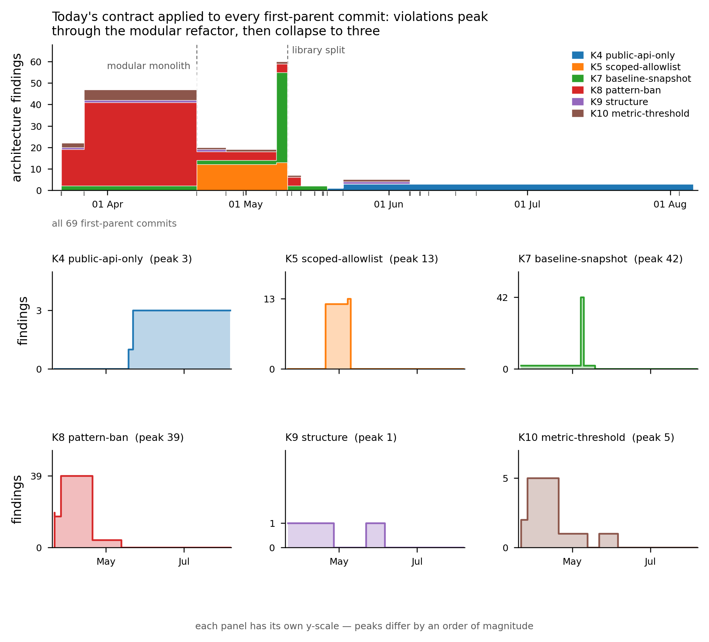

# Study 2 — repository history

Generated by `eval/study2_history.py` (measurement) and `eval/study2_metrics.py`
(metrics and figure). No number in this document is typed by hand — all of them
come from `eval/results/study2_metrics.json`,
`eval/results/study2_timeline.csv` and `eval/results/study2/index.json`.

## Reproduction

```bash
export PYTHONPATH=/Users/sebastianmatysik/'!!!!!Limen'/limen/src
python eval/study2_history.py            # 276 measurement points
python eval/study2_metrics.py            # metrics, CSV, figure data
```

## 1. Scope and sampling density

| | |
| --- | ---: |
| architectural repositories | 6 |
| first-parent commits | 69 |
| time window | 2026-03-22 .. 2026-08-03 |
| measurement points (2 axes × 2 variants) | 276 |
| modules in `units.declared` of today's spec | 32 |

**Density decision.** The protocol permits "every 10th commit or all commits
from 12 months". The LitRev history has 69 first-parent commits
over ~4.5 months; every 10th would give ~7 measurement points, too few to see
the trajectory — especially since the changes are concentrated in a few large
refactoring commits. **All** commits were taken. The `--every N` parameter
remains in the CLI for larger repositories, default 1.

## 2. Chosen timeline strategy

The specification describes a workspace of five roots (`roots[].repo`), while
history is per repository and commits are not synchronised in time. **Both**
strategies were computed:

**(b) `workspace` — main axis.** State at time T = for each repository, its
last first-parent commit with a date ≤ T. This is the only axis on which
cross-repo rules (K4 `public-api-only`, K7 `baseline-snapshot`) have anything to
police, and it is closer to the research question "how did the system's
conformance change over time".
**This is a reconstruction, not a historical state**: the combination of commits
at a given point need never have existed simultaneously on any disk.

**(a) `per-repo` — robustness control.** Each repository on its own axis, the
remaining roots empty. Cross-repo dependencies then degrade to
`unresolved-dependency` warnings, so this axis cannot assess cross-repo rules —
it serves to check whether the conclusions survive without reconstruction.

**The conclusions do not change.** The distribution of episodes per rule kind is
identical on both axes except for K4, which the `per-repo` axis cannot see by
definition (3 episodes on the `workspace` axis,
0 on `per-repo`); the shape of the trajectory (a peak
in April–May, a collapse after the library was split out, a flat tail through
August) is the same.

## 3. Methodological limitations

- **L1** one specification (today's) for the whole history; rules are NOT reconstructed per commit, so findings dated before the rule existed are anachronistic — they state that the commit would violate today's contract, not that it violated a contract in force at the time.
- **L2** --today only drives exemption expiry; all debt exemptions expire 2026-12-31, after the end of this window, so within this history it is a verified no-op (see --verify-today).
- **L3** axis 'workspace' RECONSTRUCTS the workspace at time T from each repository's last commit <= T; such a combination need not have existed simultaneously.
- **L4** before a repository's first commit its root is materialised empty; K9 structure rules still fire on it — findings carry repo_present.
- **L5** axis 'per-repo' evaluates one repository with the others empty, so cross-repository dependencies degrade to unresolved-dependency.
- **L6** units.registry_policy is relaxed from 'exact' to 'open' for the history run: 'exact' is an assertion about TODAY's module registry (the declared list is recorded verbatim in index.json as units_declared_today) and aborts every historical tree with exit 3 before any rule runs. The relaxation is verified inert on today's tree (--verify-registry) and the registry delta is recorded per commit instead.

### 3.1 Verification of `--today` (L2)

`--today` injects a date solely into the evaluation of exemption expiry
(`spec/model.py::Exemption.status`); the engine has no other clock. Checked
in the code **and empirically**: the same tree (`2026-08-03`) run with the
commit date gives **11** findings, and with a date after
expiry (`2027-01-01`) — **16**
(+5, exactly the number of debt entries; new rule_id values:
`host-into-core-baseline`, `shared-not-into-host-modules`).
Since all exemptions expire 2026-12-31, that is **after** the end of the window,
`--today` is a verified no-op within this history.
Data: `eval/results/study2/today_verification.json`.

### 3.2 Relaxation of `registry_policy` (L6)

Today's spec has `units.registry_policy: exact` with a 32-element
`declared:` list (the count is derived from `index.json` → `units_declared_today`,
not transcribed). This is an assertion about **today's** module registry
(`validate.py` S6): on every historical tree the set of discovered units is
different and limen exits with code 3 **before running any rule** — without the
relaxation the whole study would return zero findings for all 69 commits.
The history therefore runs on a specification identical to today's except for
`registry_policy: open`. The change is **verified to be inert for the results**:
on the frozen workspace both policies give
11/11 findings and **byte-identical
reports** (`reports_identical: true`;
`eval/results/study2/registry_verification.json`). The registry delta is not
discarded — it is recorded per commit as `units_declared_missing` /
`units_undeclared`, which dates the appearance of each module.

### 3.3 Three classes of findings

limen emits three classes; only the first is a code violation:

| class | what it is | treatment |
| --- | --- | --- |
| `rule` (K1–K11) | violation of a declared rule by the code | **basis of all temporal metrics** |
| `spec-integrity` (`spec-dead-entry`) | an `allow`/`exempt`/`expected`/`owners` entry that no file in the tree declares | counted separately — this is the L1 anachronism made visible: today's spec names symbols that did not exist back then |
| `unresolved` | an import not resolved to a file in the workspace | counted separately; on the `per-repo` axis inflated by construction (L5) |

On the `workspace/as-is` axis `spec-dead-entry` gives 26
episodes, all closed before the end of the window — exactly as one should
expect: as the code comes into being, today's entries stop being dead.

## 4. Trajectory — when anything happens

Below are all points on the `workspace/as-is` axis at which the number of
violations changes. The remaining 54 of 69 commits do not move
any finding — that is a result too.

| date | commit | point repo | files | violations | intro. | repaired | subject |
| --- | --- | --- | ---: | ---: | ---: | ---: | --- |
| 2026-03-22 | `c32d171` | litrev-backend | 28 | 3 | +2 | −0 | Initial commit |
| 2026-03-22 | `9cf5ac7` | litrev-frontend | 69 | 24 | +15 | −0 | Initial commit |
| 2026-03-22 | `90f8730` | litrev-frontend | 63 | 22 | +0 | −2 | Delete Kopiuj files |
| 2026-03-26 | `c1d3e42` | litrev-frontend | 99 | 47 | +11 | −1 | User management |
| 2026-04-20 | `eab22e2` | litrev-backend | 281 | 59 | +12 | −0 | Folder support and conversion of the project to a modular m |
| 2026-04-20 | `82915ff` | litrev-frontend | 415 | 20 | +3 | −22 | Folder support and conversion of the project to a modular m |
| 2026-04-26 | `feed536` | litrev-frontend | 454 | 19 | +0 | −1 | Additional options in the Projects menu |
| 2026-05-07 | `46bbf69` | litrev-backend | 545 | 60 | +41 | −0 | Comments |
| 2026-05-10 | `8e005bf` | litrev-backend | 589 | 7 | +0 | −53 | Splitting out the library |
| 2026-05-13 | `c20944b` | litrev-frontend | 486 | 2 | +0 | −3 | Splitting out the library |
| 2026-05-18 | `b03bd4f` | litrev-core-backend | 517 | 3 | +1 | −0 | Adding pdf extraction to the literature review. |
| 2026-05-18 | `6deb785` | litrev-backend | 519 | 1 | +0 | −2 | Adding pdf extraction to the literature review. |
| 2026-05-22 | `0334bc8` | litrev-frontend | 531 | 3 | +2 | −0 | Merge branch 'feat/projects-view' into 'main' |
| 2026-05-22 | `9a1d547` | litrev-backend | 532 | 5 | +2 | −0 | Merge branch 'feat/migrate-to-mariadb' into 'main' |
| 2026-06-05 | `4022b67` | litrev-frontend | 538 | 3 | +0 | −2 | Merge branch 'feat/projects-view' into 'main' |

The commit subjects above are English renderings of the original Polish commit
messages (LitRev is a Polish-language repository); the verbatim messages are
preserved in the `subject` column of `eval/results/study2_timeline.csv`.

Peak: **60** violations at `46bbf69`
(2026-05-07). End of window: **3**
violations (`1677857`), which agrees with the frozen snapshot of
Study 1 (3 errors, 8 `unresolved` warnings).

Two structural commits dominate the trajectory: "Folder support and conversion
of the project to a modular monolith" (2026-04-20) — the structure the spec
expects comes into being, and 12 K5 violations appear; and "Splitting out the
library" (2026-05-10) — 53 violations disappear in a single commit, because the
code moves to `backend-shared`, where today's rules do not pursue it.

## 5. Finding identity rule and sensitivity analysis

**Primary key: `(rule_id, file, target)`**, with the line as an auxiliary
attribute. Rationale: line numbers shift with every edit above the violation, so
a key including the line would report a "repair" and a "new violation" on every
unrelated change. `file` is a path relative to the snapshot
(`litrev-arch-snapshot/<repo>/...`), stable across commits. Where limen does not
emit a `target` (K9, K10), the key degenerates to `(rule_id, file)` — which is
exactly correct for those kinds: a file is either too large or it is not.
Findings of class `spec-integrity` have no `file`/`target`; their identity is
`spec_path`.

**Sensitivity** (`workspace/as-is` axis):

| key variant | episodes | repaired | KM median |
| --- | ---: | ---: | ---: |
| `(rule_id, file, target)` | 89 | 86 | 14.55 d |
| `(rule_id, file, target, line)` | 126 | 123 | 19.68 d |

Adding the line to the key creates **+37**
episodes (42%
more) and shifts the median from 14.55 d
to 19.68 d. This is a measure of the error
that a line-bearing key would introduce here, and it justifies the choice of the
primary key. Full data: `eval/results/study2_sensitivity.json`.

## 6. Violations introduced, repaired, time to repair

`workspace/as-is` axis, class `rule`, only repositories present at the given point:

| | |
| --- | ---: |
| violation episodes (introduced) | **89** |
| repaired within the window | **86** |
| open at the end of the window (**right-censored**) | **3** |
| median time to repair (Kaplan–Meier) | **14.55 days** |
| 95% CI (percentile bootstrap, B=10000, seed 20260804) | **[2.46, 19.68] days** |
| naive median (repaired only, no censoring) | 3.71 days |

**Censoring matters and has not been ignored.** Three episodes are open at the
end of the window — all of them `host-cross-module-public-surface` (K4), that is,
exactly the violations Study 1 reports as the remaining 3 errors. Their observed
age is 72.9–76.3 days and is **still growing**; the naive median
(3.71 d) omits them and thereby understates the result.

**An honest caveat about the KM median.** The survival curve is strongly
step-shaped, because the lifetimes are tied to a few commit dates: 41 of
89 episodes close in a single commit. After t = 2.46 d
survival is 0.5169 — just **above** 0.5 — and it drops
below only at t = 14.55 d. The KM median is therefore an
unstable quantity here, and that is precisely the content of the wide confidence
interval [2.46, 19.68].
The curve is exported in full (`km_curve` in `study2_metrics.json`) so that a
reviewer can see it rather than guess:

| t (days) | S(t) | at risk | events |
| ---: | ---: | ---: | ---: |
| 0.02 | 0.9775 | 89 | 2 |
| 2.46 | 0.5169 | 87 | 41 |
| 4.96 | 0.5056 | 46 | 1 |
| 14.55 | 0.4831 | 45 | 2 |
| 19.68 | 0.3483 | 43 | 12 |
| 22.60 | 0.3146 | 31 | 3 |
| 24.39 | 0.1910 | 28 | 11 |
| 29.35 | 0.0674 | 17 | 11 |
| 35.73 | 0.0562 | 6 | 1 |
| 57.70 | 0.0337 | 5 | 2 |

The control axis `per-repo/as-is` gives 86 episodes and a KM median of
2.46 d — lower, because without the reconstruction the
cross-repo episodes, which live longest, are invisible. The
`workspace/no-exemptions` variant: 92 episodes,
8 censored, median 14.55 d.

## 7. Distribution per rule kind

| kind | episodes (`workspace`) | episodes (`per-repo`) | peak simultaneous |
| --- | ---: | ---: | ---: |
| K1 `layer-dependency` | 0 | 0 | 0 |
| K2 `ownership` | 0 | 0 | 0 |
| K3 `consumer-allowlist` | 0 | 0 | 0 |
| K4 `public-api-only` | 3 | 0 | 3 |
| K5 `scoped-allowlist` | 13 | 13 | 13 |
| K6 `forbidden-target` | 0 | 0 | 0 |
| K7 `baseline-snapshot` | 42 | 42 | 42 |
| K8 `pattern-ban` | 22 | 22 | 39 |
| K9 `structure` | 2 | 2 | 1 |
| K10 `metric-threshold` | 7 | 7 | 5 |
| K11 `reachability` | 0 | 0 | 0 |

Five of the eleven kinds do not fire **even once** in the whole history:
K1 `layer-dependency`, K2 `ownership`, K3 `consumer-allowlist`,
K6 `forbidden-target` (it fires only in the no-exemptions variant) and
K11 `reachability` (unused in the spec — 0 rules). **This is a result, not
missing data**: the layering and ownership rules were not broken even once in
this history, and the distribution of violations is dominated by K7 (42
episodes) and K8 (22) — that is, by the snapshot baseline
and the textual bans, not by module boundaries.

## 8. Exemption lifetimes

`limen spec stats` on today's tree:

```
rules per kind:
  baseline-snapshot: 3
  consumer-allowlist: 1
  forbidden-target: 6
  layer-dependency: 4
  metric-threshold: 4
  ownership: 1
  pattern-ban: 4
  public-api-only: 3
  scoped-allowlist: 5
  structure: 5
exemptions: 4 total, 4 active, 0 expired
  median age: 0 days
  median declared lifetime (expires - since): 149 days
```

All four exemptions have `since: 2026-08-04`, that is, they came into being on
the day of the specification retrofit and **have no history of their own** —
`spec stats` on any historical tree will return the same four entries. What does
have a history is **the debt these exemptions legalise**, and that is a
measurable quantity: a finding present in the `no-exemptions` variant and absent
in `as-is` at the same point is a violation that today's spec forgives.

| rule | kind | first seen in code | actual age (days) | declared lifetime (days) | state at end |
| --- | --- | --- | ---: | ---: | --- |
| `shared-not-into-host-modules` | K6 | 2026-05-10 | 85.0 | 149 | open |
| `host-cross-module-public-surface` | K4 | 2026-05-18 | 76.3 | 149 | open |
| `host-cross-module-public-surface` | K4 | 2026-05-18 | 76.3 | 149 | open |
| `host-into-core-baseline` | K7 | 2026-05-18 | 76.3 | 149 | open |
| `host-into-core-baseline` | K7 | 2026-05-18 | 76.3 | 149 | open |

Median **actual** age of the debt: **76.32 days**,
against a median **declared** lifetime of 149 days
and a median exemption age reported by `spec stats` of 0 days. In other words:
the exemptions are young (median age 0–2 days), but the debt they describe is
about 76 days old and all
5 violations are still open at the end of the window.
This difference is the main argument for measuring debt from history rather than
from specification metadata.

## 9. Figure



Top panel: cumulative number of violations over time, broken down by rule kind
(the state is held from one commit to the next — hence steps, not interpolation).
Bottom panels: small multiples per kind, **each with its own Y scale**, because
the peaks differ by an order of magnitude. Source data: `study2_timeline.csv`
(columns `n_K1`..`n_K11`, `introduced`, `repaired`), `study2_per_kind.csv`.

## 10. Artefacts

| file | content |
| --- | --- |
| `eval/study2_history.py` | per-commit measurement; the header contains the full list of limitations |
| `eval/study2_metrics.py` | temporal metrics, KM with censoring, bootstrap, sensitivity analysis |
| `eval/results/study2/**/<sha>.json` | 276 measurement points (incremental, `--resume`) |
| `eval/results/study2/index.json` | run manifest, `limitations`, `spec_stats`, `units_declared_today` |
| `eval/results/study2_timeline.csv` | one row per measurement point |
| `eval/results/study2_per_kind.csv` | violations per rule kind per point |
| `eval/results/study2_findings.csv` | raw grain: one row per (point, finding) |
| `eval/results/study2_lifetimes.csv` | one row per episode, with a censoring flag |
| `eval/results/study2_exemption_lifetimes.csv` | actual age of the debt forgiven by the exemptions |
| `eval/results/study2_sensitivity.json` | sensitivity to the identity rule |
| `eval/results/study2_metrics.json` | all numbers cited above |
| `eval/results/study2_violations_over_time.png` | figure, 300 dpi |
